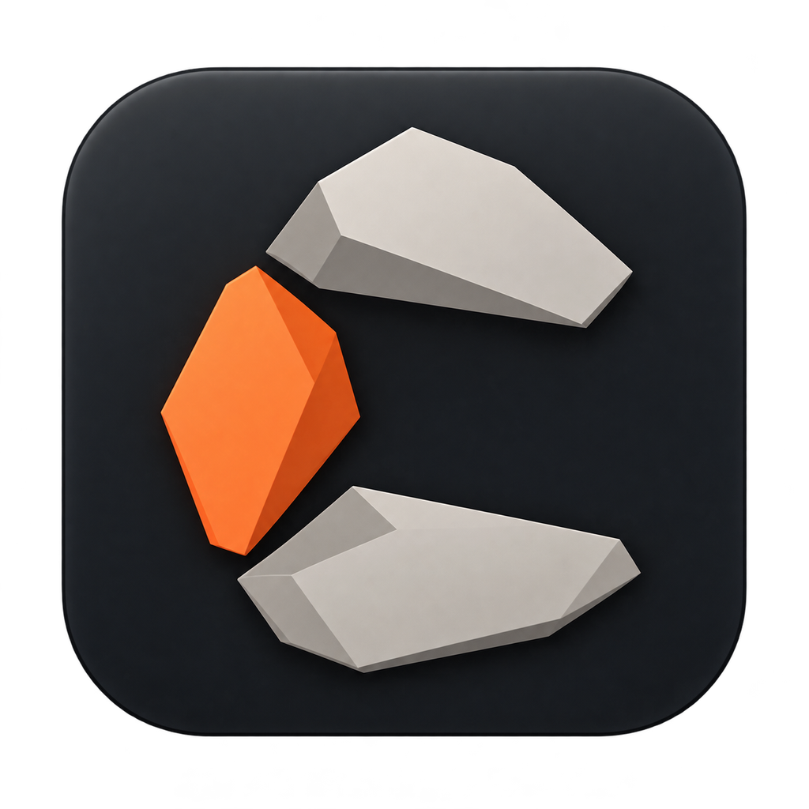
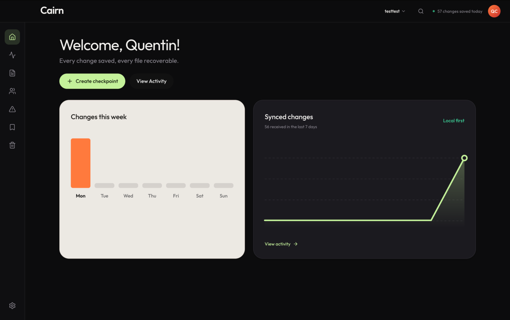
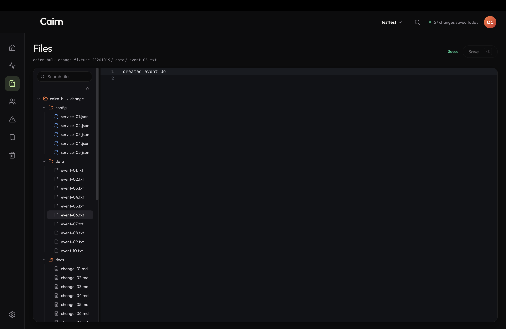
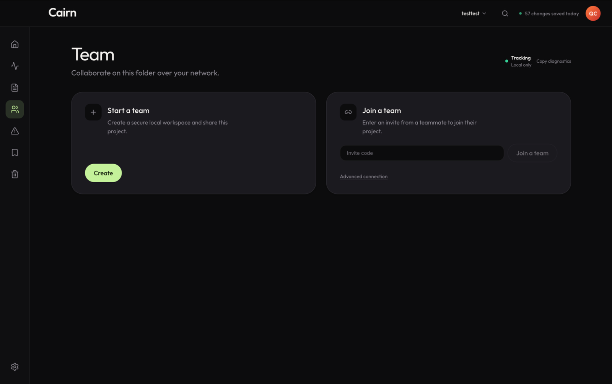
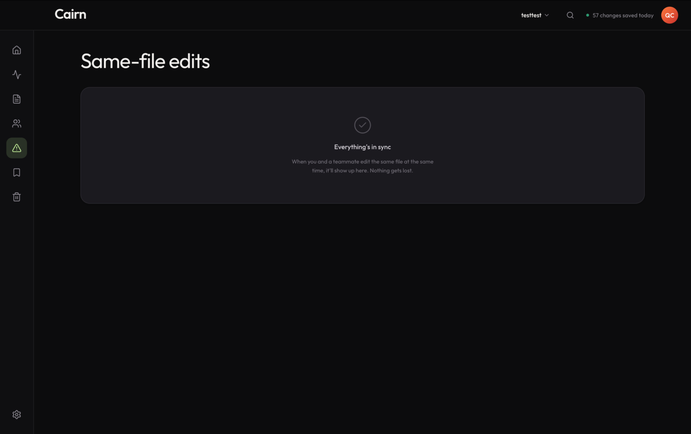
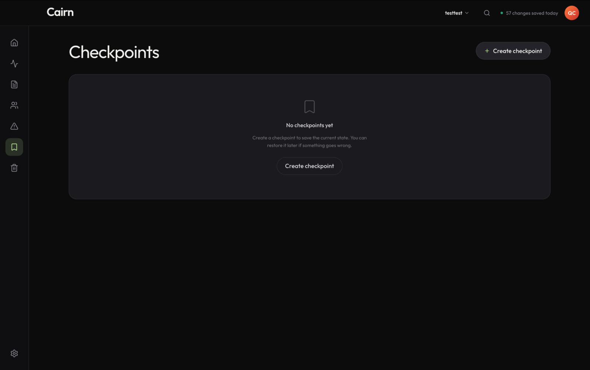
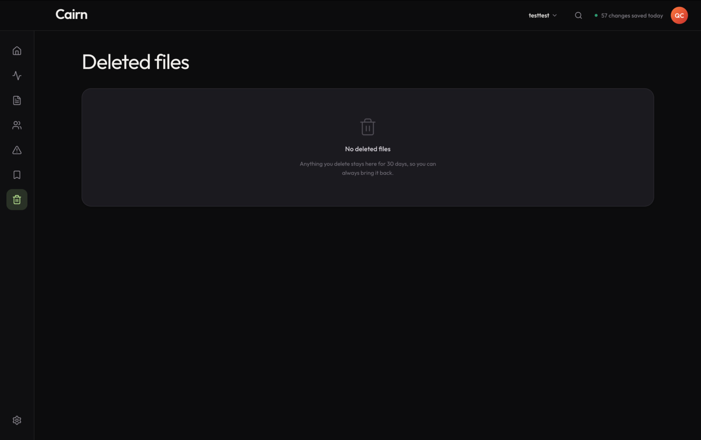
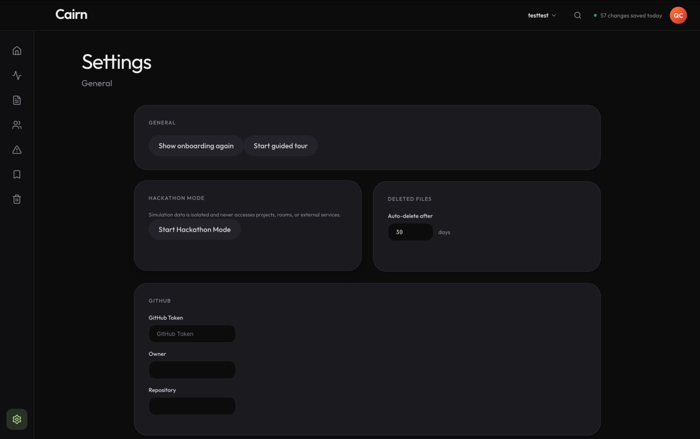

<p align="center">
  
</p>

<h1 align="center">Cairn</h1>

<p align="center"><strong>Know what changed. Catch overlap early. Recover with confidence.</strong></p>

<p align="center">
  A local-first desktop workspace for developers and AI coding agents.<br>
  Follow project activity, collaborate peer-to-peer, and restore the work that matters.
</p>

<p align="center">
  <a href="https://github.com/lol40560/Cairn/releases">Download for macOS or Windows</a>
  &nbsp;&nbsp;·&nbsp;&nbsp;
  <a href="#quick-start">Get started</a>
  &nbsp;&nbsp;·&nbsp;&nbsp;
  <a href="#how-cairn-works">How it works</a>
</p>

<p align="center">
  <a href="https://github.com/lol40560/Cairn/releases/tag/v2.0.0-rc.3"></a>
  <a href="./LICENSE"></a>
  
</p>

<p align="center">
  
</p>

> **Release status:** Cairn v2.0.0-rc.3 is a release candidate. The macOS and Windows installers are not code-signed. See [known limitations](#known-limitations) before relying on it for critical work.

## Why Cairn?

Modern development happens across people, editors, and AI coding tools. Several tools may change the same project in minutes, but understanding *what happened*, *where work overlaps*, and *how to recover* still takes effort.

**Cairn keeps those answers close to your files.** It observes local project changes, organizes a readable activity trail, flags possible overlapping edits, and provides file-level recovery tools. When you choose to collaborate, it shares project updates directly with teammates rather than through a Cairn-hosted cloud service.

| See the work | Work together | Keep a way back |
| :--- | :--- | :--- |
| File-grouped activity, search, contributor context, and readable diffs. | Peer-to-peer project sharing and awareness of possible concurrent edits. | Checkpoints, protected restores, conflict review, and deleted-file recovery. |

## Inside Cairn

### A home for every project

See recent activity and project context without jumping between a terminal, a file explorer, and a version-control interface. Cairn's workspace surfaces recent changes while keeping your files central.

### Your files, with the context attached

Browse a project tree, inspect code in the integrated Monaco editor, and save edits from within Cairn. Quick Open, a command palette, keyboard navigation, and change diffs make it easier to move from an activity event to the actual file.

<p align="center">
  
</p>

### Collaboration without a Cairn account

Create a team for a project, share an invitation, and connect with peers over a reachable network. Cairn uses protocol-v4 authenticated, encrypted peer transport and provides direct-connection troubleshooting when automatic discovery is unavailable.

<p align="center">
  
</p>

### Built for the messy moments

Potential overlap is different from a confirmed conflict. Cairn helps distinguish the two, gives you a place to review same-file edits, and retains recovery options when you need to inspect or restore an earlier state.

<table>
  <tr>
    <td width="50%" align="center"></td>
    <td width="50%" align="center"></td>
  </tr>
  <tr>
    <td align="center"><strong>Conflict review</strong><br>Inspect same-file edits and resolve confirmed conflicts.</td>
    <td align="center"><strong>Checkpoints</strong><br>Save recoverable snapshots before you need them.</td>
  </tr>
</table>

<details>
  <summary><strong>More screens: deleted files and settings</strong></summary>
  <p>Recover recently deleted files from local trash, configure retention, and access application and GitHub integration settings.</p>
  <p></p>
  <p></p>
</details>

## What Cairn can do

- **Readable change history.** Group operations into activity sessions, filter by contributor, search activity, and inspect file diffs.
- **Human + AI context.** Attribute known edits to contributors and AI tools so activity is easier to follow.
- **Overlap and conflict awareness.** Surface potential same-file interference separately from confirmed conflicts and provide review and resolution tools.
- **Recovery by design.** Create checkpoints, compare revisions, safeguard destructive restores, and retrieve deleted files during the configured retention period.
- **Local peer collaboration.** Share a project using invitations, with peer health and direct-connection diagnostics.
- **Developer-focused extras.** Edit files in Monaco, export changes to a GitHub pull request on request, and explore features safely in an isolated Hackathon Simulation.

## Quick start

**1. Download the app.** Get the latest available installer from [GitHub Releases](https://github.com/lol40560/Cairn/releases). Choose the macOS `.dmg` for your architecture or the Windows `Cairn-Setup-*.exe`. Current release-candidate builds are unsigned.

**2. Open a project.** Launch Cairn and choose a project folder. Its dashboard gives you a place to inspect activity and files.

**3. Share it when needed.** Open **Team**, choose **Start a team**, and give a teammate the invitation. Teammates can choose **Join a team** and retrieve the project into their selected folder.

**4. Use the recovery tools.** Create a checkpoint before a risky change; inspect **Same-file edits** if collaboration produces overlapping work; recover eligible deleted files from **Deleted files**.

> **Network note:** For automatic discovery, collaborators should be on the same reachable Wi-Fi network or hotspot. If discovery is blocked, open the Team screen's advanced direct-connection option and use the host's `IP:port` address. Some campus and corporate networks block device-to-device traffic.

## How Cairn works

```text
Your project folder
       │
       ▼
Local file watcher ──► Local operation history ──► Activity & diffs
       │                        │
       │                        └──► Checkpoints & recovery
       │
       └──► Authenticated, encrypted P2P connection
                              │
                              ▼
                      Invited teammates
```

Cairn watches the selected folder and stores local project history in `.cairn/`. When you start or join a team, it exchanges project changes with participating peers. Deleted files are retained in `.cairn/trash/` for the configured period (30 days by default). GitHub export happens only when you request it.

**Local-first does not mean a guarantee of full synchronization.** Cairn reports observed watcher and peer-connection states, but its protocol does not yet prove full-project convergence through acknowledgements. Checkpoints and deleted-file recovery are additional safeguards, not substitutes for external backups.

For implementation details, see [Architecture](./ARCHITECTURE.md) and [UI design principles](./UI.md).

## Keyboard shortcuts

| Action | Shortcut |
| :--- | :--- |
| Quick Open | `Cmd/Ctrl + P` |
| Command Palette | `Cmd/Ctrl + K` |
| Save current file | `Cmd/Ctrl + S` |
| Home, Activity, Files, Team, Conflicts | `Cmd/Ctrl + 1–5` |
| Settings | `Cmd/Ctrl + ,` |

## Development

Cairn is built with Electron, React, TypeScript, Tailwind CSS, Monaco, SQLite, and local peer-to-peer networking. The UI reaches file and networking services through Electron's preload IPC boundary.

Requires **Node.js 22+** and **npm**.

```bash
git clone https://github.com/lol40560/Cairn.git
cd Cairn
npm install
npm run dev
```

Useful development commands:

```bash
npm test          # run tests
npm run lint      # run ESLint
npm run build     # compile the app
npm run dist:mac  # package for macOS
npm run dist:win  # package for Windows (on Windows)
```

See the [architecture overview](./ARCHITECTURE.md), [design system](./UI.md), and [release notes](./RELEASE_NOTES.md) for deeper information.

## Known limitations

- **Release candidate:** Current installers are unsigned; macOS Gatekeeper and Windows SmartScreen may display warnings. Review the release before installing.
- **No convergence proof:** The protocol does not yet acknowledge full-project convergence.
- **Session rollback:** Session-level rollback is analysis-only; a safe automatic three-way revert has not been implemented.
- **Binary conflicts:** Binary comparison shows metadata, not a visual content diff.
- **Recovery scope:** Checkpoints protect against some accidental or conflicting changes but are not a replacement for an external backup.

For support and known issues, visit [GitHub Issues](https://github.com/lol40560/Cairn/issues).

## Privacy, license & acknowledgments

No Cairn-operated account service, telemetry pipeline, or cloud backend is required. When you explicitly collaborate or export to GitHub, selected project data is transmitted to peers or GitHub as needed. Read the [Privacy Policy](./PRIVACY.md) for details.

Cairn is open source under the [MIT License](./LICENSE). See the [Terms of Use](./TERMS.md) and [Third-party Notices](./THIRD_PARTY_NOTICES.md).

<p align="center">
  <strong>Built for the way code changes now.</strong><br>
  <sub>Local-first collaboration · Change awareness · Recovery</sub>
</p>
