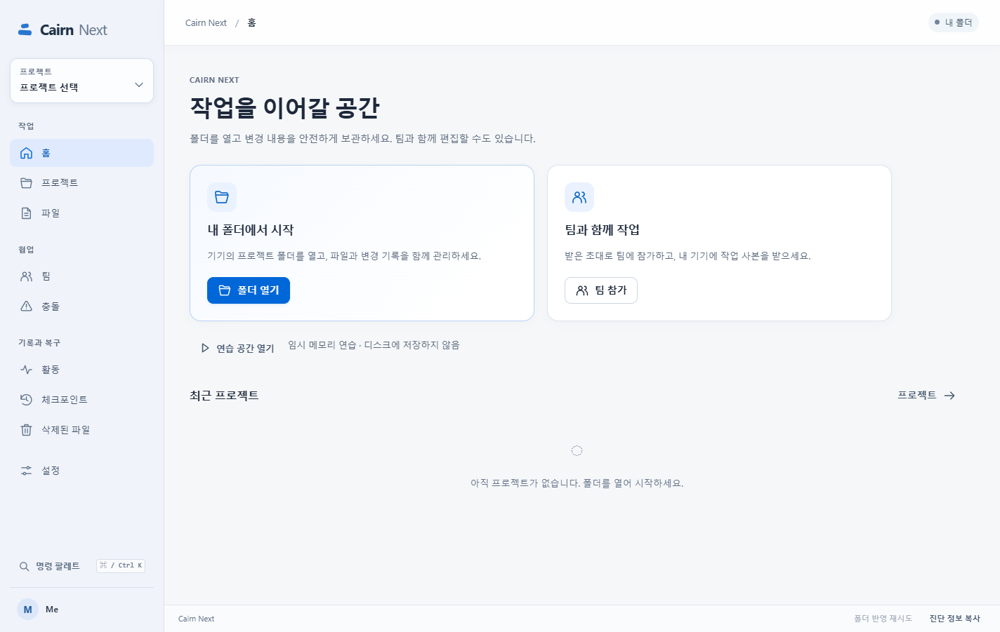
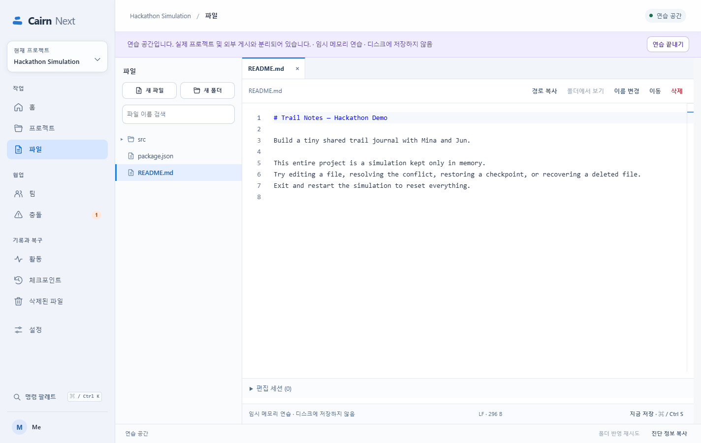

# Cairn Next · 0.2.0-rc.2

Cairn Next is a desktop app for local project folders and whole-project collaboration over a LAN. This release candidate adds a brighter interface to the existing Monaco/Yjs editor, file operations, activity history, conflicts, checkpoints, and recovery tools. The interface supports Korean, English, and Traditional Chinese.

This directory contains a separate application alongside the original Cairn app at the repository root. Their collaboration protocols and internal data formats do **not** interoperate, and existing Cairn or Cairn Next 0.1.x databases are **not** automatically migrated. Preserve the original folder and import a copy of its ordinary files into a new folder.

**This branch publishes source code, not a binary Release.** Installers and packaged apps from earlier local trials are not tracked here and cannot be downloaded from this branch. The app's license marker remains `UNLICENSED`; publishing the source does not change its license.

## Run from source

Use **Node.js 24.x (24.19.0 or newer)** and **pnpm 11.25.0**. From the repository root:

```sh
cd cairn-next
pnpm install --frozen-lockfile
pnpm build
pnpm start
```

Run the checks from the same directory after building:

```sh
pnpm check
pnpm test
pnpm runtime:check
pnpm test:desktop
```

`pnpm verify` runs type checks, the build, and core tests together. Desktop tests launch actual Electron apps with isolated test folders and profiles. Windows packaging and the unverified macOS build procedure are described in the [user guide](docs/user-guide.md#설치와-제거).

## Work locally or with a team

Open a project folder, choose a file, and edit locally. To collaborate, create a team and share an editor or viewer invitation through a trusted channel. Participants choose an empty work folder and wait for the initial transfer and verification to finish. Nearby discovery is optional; invitations also support direct connections.

Local editing uses a loopback connection. Creating a team opens that project's connection to the LAN. **The host app and PC must stay running for team collaboration.** Closing the host app or suspending the PC stops the connection. **PC server — Coming Soon** is informational only; this version has no tray hosting, independent server mode, automatic startup, or internet relay.

| Content | Limit |
| --- | --- |
| Editable text | UTF-8 with consistent LF or CRLF; up to 1 MiB per file |
| Binary files and larger text | Up to 16 MiB per file; byte-preserving transfer |
| Current project content | Up to 256 MiB and 5,000 files/directories |
| Yjs state or update | Up to 4 MiB each |

Unsupported files stay on disk. Shared ignore rules exclude credentials, app metadata, version-control data, dependencies, and build output; filename rules cannot detect every secret. History and recovery copies use additional disk space. Back up the entire project, including `.cairn-next`, after closing the app normally. ZIP export contains current files, not the full recovery history.

## Screenshots





## Verification and documentation

[Validation of this source branch](docs/publish-check.md): the imported package passed its fresh Windows checks, including 163 core tests and 10 actual Electron flows.

Historical Windows records report 163 core checks, 10 packaged-app flows, and two startup-close checks. RC1 also completed seven installer steps; the RC2 UI candidate's installer was not reinstalled in that record. These are local verification records, not proof for every platform or a new test run of every checkout. Physical two-PC LAN, macOS, real OS IME, and live GitHub export remain unverified. Raw local QA reports and test profiles are not included in the repository.

- [User guide (Korean)](docs/user-guide.md), [privacy and networking](docs/privacy.md)
- [Release readiness and historical verification](docs/release-readiness.md), [RC1 verification details](docs/release-validation.md), [two-device checklist](docs/two-device-check.md)
- [Implementation contract](docs/implementation-contract.md), [module API](docs/module-api.md), [historical architecture](docs/architecture.md)
- [Changelog](CHANGELOG.md), [third-party notices](THIRD_PARTY_NOTICES.md)

Third-party notices cover their respective dependencies and do not grant a license to Cairn Next itself.
