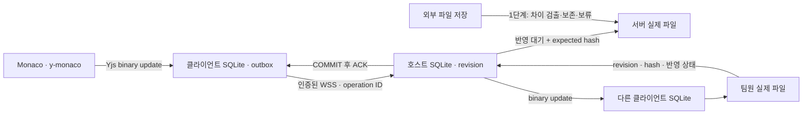

# Cairn Next — 0.1.0 설계 기록

> 이 문서는 0.1.0의 역사적 설계 기록입니다. 현재 0.2.0-rc.2의 프로젝트 단위 구현은 [현재 설계](implementation-contract.md), [모듈 계약](module-api.md), [출시 준비 상태](release-readiness.md)를 참고하세요. 아래의 단일 파일 범위·트레이·독립 서버 설명은 현재 제품 동작이 아닙니다. 현재 앱을 완전히 종료하면 팀 연결도 종료되며 PC 서버는 Coming Soon 안내만 제공합니다.

설계일: 2026-10-26. 기존 기능 조사 기준은 `afc09834c1f0ce206ab08ec042262c4955ea710c` (PR #5 병합)였습니다. 당시 기존 Cairn 소스와 사용자 데이터를 보존하기 위해 새 구현과 저장 공간을 분리했습니다. 현재도 두 앱의 프로토콜·내부 데이터는 호환되지 않으며 자동 마이그레이션은 제공하지 않습니다.

## 책임과 데이터 흐름

Electron renderer (Monaco + y-monaco + Y.Doc) → 제한된 preload → 클라이언트 코어/SQLite outbox → 인증된 WSS → 서버 코어/SQLite 트랜잭션 → durable ACK → 파일 반영 대기 작업 → 실제 파일.

호스트 편집도 동일한 WSS 클라이언트 경로를 거친다. 서버는 UI와 독립 실행 가능하다. 서버 파일 writer는 서버 하나, 참가자 작업 폴더 writer는 해당 클라이언트 하나다. 프로젝트 내부의 별도 소유권 SQLite DB에서 OS 잠금을 유지하여 GUI/CLI 중복 소유를 거절한다. 일반 재시작은 projectId/fileId/generation/Yjs identity를 유지한다.

서버의 원본은 Yjs binary state와 operation log, 파일 메타데이터다. 텍스트 파일은 반영 결과다. 클라이언트는 local binary state와 outbox를 같은 SQLite 트랜잭션으로 저장한 뒤 전송한다. 서버는 인증/권한/문서 세대/operation ID/크기/구조를 검증하고, 복제한 문서에 적용한 결과를 SQLite WAL + synchronous FULL로 COMMIT한 뒤에만 ACK한다. 인메모리 문서는 COMMIT 성공 후 교체한다. ACK는 파일 반영 완료를 뜻하지 않는다. 동일 operation ID 재전송은 이전 결과를 반환하며 내용이 다르면 거부한다.

## 파일 반영과 복구

DB와 파일은 별개의 트랜잭션이다. DB 안에 반영할 state/revision/hash와 마지막 반영 hash를 남긴다. 실제 파일 내용이 마지막 hash 또는 목표 hash와 일치할 때만 교체한다. 임시 파일을 동일 디렉터리에 쓰고 fsync한 후 대상 파일을 다시 확인한다. 예상과 다르면 외부 파일과 서버 상태를 보존하고 반영을 blocked로 둔다. 시작 시 pending을 재처리한다. 이 방식이 임의의 외부 프로세스와 원자적 compare-and-swap을 제공하지는 않으므로 교체 전 기존 파일의 복구 사본도 보존한다. 파일 잠금/권한/용량 부족은 durable 상태와 구분한다. 앱 내부 DB/WAL 및 복구 파일을 수동 삭제하지 않는다.

실제 교체는 `fsync된 임시 파일 + 복구 intent → 기존 bytes 동결 사본 → 기존 파일을 recovery로 이동 → 빈 목적지에 hard-link로 새 파일 게시` 순서다. 게시 중 외부 프로그램이 목적지를 새로 만들면 덮어쓰지 않는다. 이동 직후 종료된 경우에는 해당 intent와 보존 파일을 확인해 복구한다. 이전 inode를 외부 에디터가 계속 열고 있을 가능성 때문에 이동한 파일도 지우지 않는다. 모든 일반 파일 읽기는 앞선 stat만 믿지 않고 읽는 양 자체도 제한한다.

이는 프로세스 강제 종료 복구를 시험한 설계다. 실제 전원 차단, 저장 장치 캐시 오류, 네트워크 파일시스템의 원자성까지 검증한 것은 아니다. 로컬 보관 ACK 전에 renderer에만 있는 입력은 별도로 표시하며, DB 쓰기 자체가 불가능하면 창을 닫지 않도록 보호한다.

1단계는 선택한 신규/전용 폴더의 UTF-8 텍스트 1개(1 MiB 이하)만 공유한다. `.cairn`이 있는 폴더와 이미 사용 중인 클라이언트 폴더를 가져오는 흐름은 거절한다. 기존 프로젝트 전체 및 외부 저장 자동 수용은 2단계다. 외부 저장을 확인하지 않고 CRDT 전체를 치환하지 않는다.

## 연결과 신원

서버 UUID와 IP를 분리한다. 매 재접속 때 프로토콜 버전·서버/프로젝트/파일 ID·generation·권한·유효기간을 검증한다. TLS 인증서를 초대에 고정하고 SHA-256 fingerprint를 사용자에게 표시한다. 초대는 신뢰하는 경로로 교환한다. 인증서는 해당 연결의 CA로만 신뢰하고 fingerprint/서버 이름을 검증한다. 전역 인증서 검증 해제는 금지한다. token은 URL이나 로그에 넣지 않는다. mDNS는 2단계 이후 편의 기능이며 수동 WSS 연결은 독립적으로 실행한다.

인증 후 클라이언트는 5초마다 nonce를 넣은 ping을 전송하고 해당 pong을 확인한다. 응답 확인이 15초간 없으면 연결을 오프라인으로 전환하고 outbox를 보존한 채 재인증을 시도한다. 전원 종료·절전·네트워크 차단 중 어느 원인인지를 관측 없이 단정하지 않는다. 접속이 없어도 소켓이 살아 보이는 상황은 별도 TCP blackhole 시험으로 검증한다.

## 상태와 확인 범위

메모리에만 있음 → 내 기기에 보관됨 → 서버 전송 대기 → 서버 영속 저장 → 서버/로컬 파일 반영 → 현재 연결된 팀원의 적용 확인을 따로 표시한다. 프로젝트 전체 완료 상태는 1단계에서 사용하지 않는다. 단일 파일의 확인 revision만 표시한다. 새 변경, pending outbox, 불일치 hash, 접속자 변경은 완료 표시를 무효화한다. 오프라인 사용자는 확인 대상에서 제외했다고 명시한다. provider synced 이벤트를 저장 판정으로 사용하지 않는다.

## 기술 선택

Electron/React/TypeScript/Monaco/Yjs/y-monaco를 사용한다. Hocuspocus 4.7.1을 우선 검토했지만 onStoreDocument의 debounce와 일반 synced 이벤트는 요구하는 작업별 durable ACK와 동일하지 않다. 1단계는 유지보수되는 `ws` 위에 작은 명시적 메시지 계층을 사용한다. Yjs 알고리즘 자체를 구현하지 않는다. Hocuspocus 도입은 이 ACK/outbox/권한 계약을 유지하는 어댑터로 후속 검토 가능하다.

SQLite는 Node 내장 `node:sqlite` DatabaseSync를 사용한다. Electron/CLI 간 native addon ABI 재빌드 문제를 피한다. 해당 API의 실험적/RC 상태 및 실제 Electron 제공 런타임은 검사 결과에 기록한다. 초기 대상은 Windows 10 x64 호스트(현재 시험 환경)와 macOS 클라이언트이다. 실제 macOS와 두 물리 기기 시험 전에는 지원 검증 완료를 선언하지 않는다.

## 1단계 실제 저장 모델

| 저장소            | 테이블/파일                                                          | 역할                                                                                                               |
| ----------------- | -------------------------------------------------------------------- | ------------------------------------------------------------------------------------------------------------------ |
| 서버 SQLite       | `project`                                                            | 단일 파일의 serverId/projectId/fileId/generation, Yjs binary state, revision/hash, 마지막 반영 hash·상태, TLS 신원 |
| 서버 SQLite       | `members`                                                            | 초대별 member ID, token hash, Owner/Editor/Viewer, 만료·회수                                                       |
| 서버 SQLite       | `operations`                                                         | operation ID, member ID, payload hash, 서버 revision, binary update, 저장 시각                                     |
| 클라이언트 SQLite | `metadata`                                                           | 고정 서버·프로젝트·파일·세대·client ID. 평문 token 없음                                                            |
| 클라이언트 SQLite | `document`                                                           | 로컬 병합 상태와 별도 서버 binary 상태, 검증한 revision/hash, 파일 반영 상태                                       |
| 클라이언트 SQLite | `outbox`                                                             | 순서가 있는 미전송/거부 update와 거부 사유                                                                         |
| 클라이언트 SQLite | `receipts`                                                           | 검증한 durable ACK 기록                                                                                            |
| 별도 SQLite       | `ownership.sqlite`                                                   | 프로세스 수명 동안 OS의 배타적 파일 잠금. PID 파일을 추측해 삭제하지 않음                                          |
| 복구 디렉터리     | `version-*`, `moved-*`, `external-*`, `intent-*`, `rejected-local-*` | 파일 이전 버전, 교체 경합·중단 복구, 거부 입력 보존                                                                |

클라이언트는 순서가 있는 outbox에서 한 작업씩 전송한다. 서버 저장 실패는 outbox를 지우지 않고 재시도한다. 영구 거부된 작업의 뒤에 의존하는 변경을 무조건 계속 보내지 않는다. 같은 generation의 서버 revision 후퇴나 hash 모순은 복원으로 간주하지 않고 자동 적용을 거부한다.

LF/CRLF는 텍스트 내용에서 매번 추측하지 않고 파일의 `line_ending` 메타데이터로 서버와 클라이언트에 보관한다. 내용이 비어도 재시작 후 형식을 유지한다. Monaco에는 최초 내용 적용 전에 같은 형식을 설정한다. 같은 generation에서 줄바꿈 형식을 몰래 바꾸는 변경은 거절하고 복구 사본을 남긴다. 형식 변환은 후속 명시적 작업으로 분리한다.

공식 참고: [Yjs binary updates](https://docs.yjs.dev/api/document-updates), [y-monaco](https://github.com/yjs/y-monaco), [Hocuspocus hooks](https://tiptap.dev/docs/hocuspocus/server/hooks), [SQLite](https://nodejs.org/api/sqlite.html), [Electron 보안](https://www.electronjs.org/docs/latest/tutorial/security), [ws](https://github.com/websockets/ws). 정확한 버전은 package.json/lockfile에 고정한다.

## 당시 계획한 후속 데이터 모델과 정책

아래는 0.1.0 당시의 단계별 계획입니다. 프로젝트 동기화·복구·내보내기 등은 이후 0.2.0 후보에서 구현됐으므로 현재의 미구현 목록으로 해석하지 않습니다. 선택적 자동 시작과 독립 서버는 현재 제공하지 않습니다.

2단계: projects, members, files(fileId/path/caseFoldedPath/generation/tombstone), operations(revision/opId/author/source), y_states, blobs(hash), projections(expectedHash/targetHash), client_outbox, conflicts(base/local/remote), snapshots(revision + manifest). 경로 변경은 fileId를 유지하고 서버 revision을 부여한다. 삭제 tombstone은 늦은 변경을 복구 기록으로 격리한다. snapshot revision R을 내려받고 R 이후 로그를 따라잡아 manifest/hash를 검증한다. 다운로드는 staging에 쓰며 기존 폴더를 덮어쓰지 않는다.

3단계: checkpoint 복원 전 보호 checkpoint와 영향 미리보기, 복원은 새 작업으로 기록하고 해당 문서 generation을 증가시킨다. 옛 generation outbox는 로컬 보존+검토로 보내며 자동 적용하지 않는다. claims는 기준 revision/hash와 만료 시각을 보관한다. 외부 세션 동안 원격 디스크 반영을 보류한다. 운영체제의 외부 쓰기를 막는 잠금으로 설명하지 않는다.

4–5단계: snapshot/GitHub PR 내보내기는 명시적 사용자 작업, OS 자격 증명 저장소, 한국어/영어/번체, 독립 데모, 데이터 보존 설치/업데이트, 사설 네트워크, 선택적 자동 시작. 자동 포트 개방·공개 인터넷 노출·자동 호스트 승계는 포함하지 않는다.
